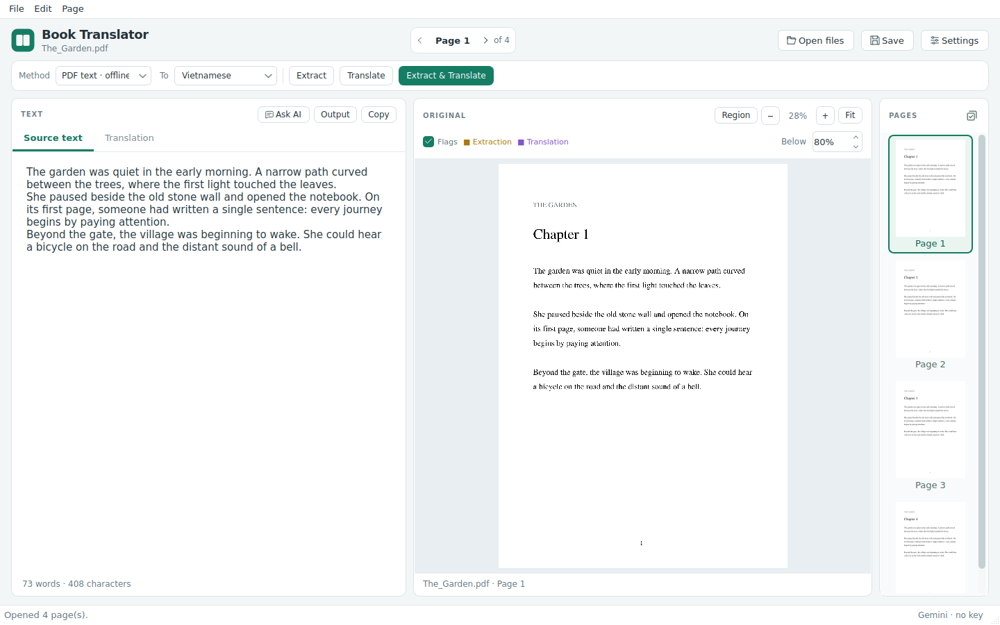
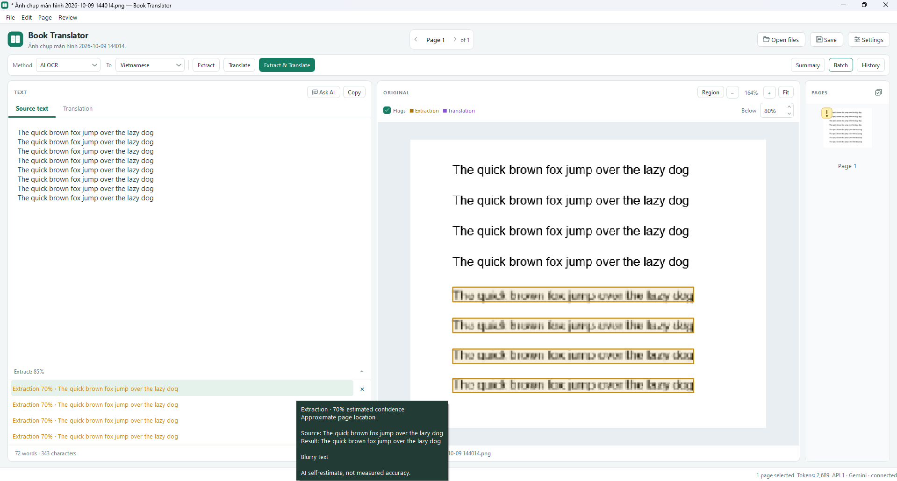
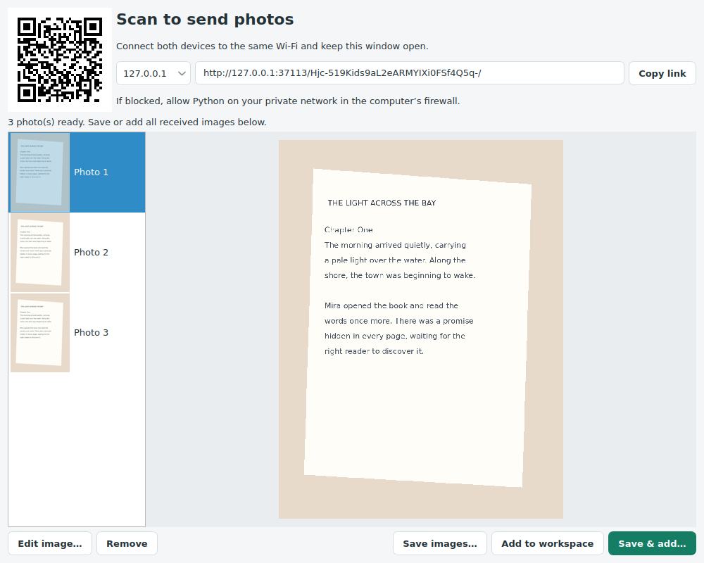
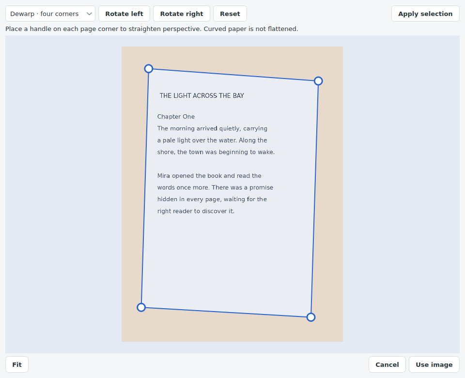
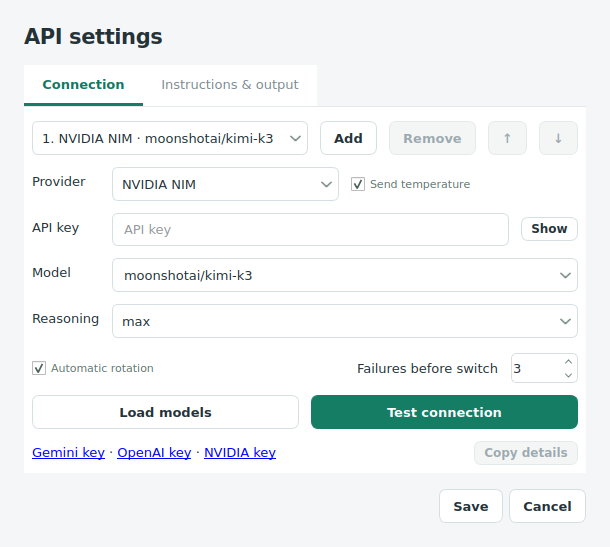

# Book Translator 1.29.0


A Python desktop app for extracting and translating books powered by AI. Made entirely with GPT 6 Astra.
Editable text is on the left, the original page is on the right, and a scrollable
thumbnail strip lets you jump between pages.

## Feautures
1. Batch processing: Extract or translate multiple book pages with context aware, and automatically summarize to provide context for next pages. Progress window show token usage (None for PDF mode), status, and detailed infomations.
2. Send from phone: Capture images of book pages and send them to the app directly with full quality, images are editable and can be saved. PDF and images import exist for the local file of computer.
3. Page review: Automatically flags the low confidence page and passage, individual flagged passage are clickable to focus on the highlighted box on the image and text, hover for detail. Flagged pages and passage can be navigated with keybind.
4. AI chat: AI chat window directly inside the app, select text, or image region to ask questions and apply suggested editing in a single button.
5. API rotation: Rotate through multiple API and providers for almost unlimited usage. Available provider include Google, Nvidia Nim, and Open AI. Google gemini are recommended since it is fast and have up to 1000 request per day (Multiple model can be used in one API, rotate between models like 3.5 flash lite, and 3.1 flash lite. ). Nvidia are free but slow.
6. Instruction & Output: Customize AI instruction for specific output. For example I'm using this app to make audio book so i used "Translate for a audio book, change writing to fit, describe figures if present, and remove unnecessary text that wont be used in a audio book". As you can see the possibility are endless, you can do whatever you want!
7. Consistent Output: AI will be fed pages context, images, and temperature for consistent and unchanged output style across pages. The AI can also edit previous page ending to make the text consistent for purpose like what I'm doing. For example if the first page image text is "This is..." and second page is "a continuous sentence", the AI will correct the previous page ending. Together the text will be "This is a continuous sentence" instead of "This is... a continuous sentence"
8. Page history: History of pages are kept for recovery
9. Project saving: Save work space as btproject for reopening later.
10. Multi languages support: Translate or extract every language that the AI suport (type your language if the drop down dont have). The GUI also support multi language translation of vietnamese and english are included. More can be added.



The image show example of Page Review feauture. The blurry bottom passages was highlighted by AI.
## Run on Windows

Install Python 3.12 or later, extract this ZIP, and open a terminal in the folder
containing `main.py`. Install the dependencies once:

```powershell
py -3 -m pip install -r requirements.txt
```

Start the app:

```powershell
py -3 main.py
```

There is no batch launcher or automatic environment creation. If you normally
use `python` instead of `py -3`, use it for both commands. In VS Code, select that
same Python interpreter and run `main.py`.

On macOS or Linux, use `python3` in place of `py -3`. Linux also needs a graphical
desktop and Qt's system libraries.

## Build a Windows .exe

On Windows with Python 3.12, run:

```powershell
py -3.12 build_exe.py
```

The script installs build dependencies and creates
`dist/BookTranslator/BookTranslator.exe`. Share the entire output folder.
Use `--onefile` for a single `dist/BookTranslator.exe`, or `--console` to debug.
See [BUILDING.md](BUILDING.md) for all options and Windows verification steps.

## Use the app

1. **Open files**: add PDFs, page images, or a mixture of both to the current workspace. PNG, JPG, WEBP, BMP,
   TIFF, multi-page TIFF, and password-protected PDFs are supported.
2. **Extract text**: choose **PDF text · offline** for selectable text, or
   **AI OCR** for scans and images.
3. Edit the **Source text**, choose a language, and click **Translate text**.
   Translation uses the current source text, including your edits.
4. Navigate with **< / >**, the page label, or the thumbnails. Each page keeps
   its own source and translation.
5. **Save project** to continue later. **File → Export text** exports source,
   translations, or both as a UTF-8 text file. Uncheck **Show page headers** in the
   export options to omit page headings, then click **Continue** to choose a file.

Drag the preview to pan. Scroll or use +/- to zoom. Double-click or click **Fit**
to fit the page. The page is horizontally centered when opened, fitted, or when
the preview panel is resized. Drag the dividers to resize the panels.

The selected model returns confidence estimates for extraction and translation. Amber boxes
mark uncertain extraction; purple dashed boxes mark uncertain translation.
Adjust the threshold above the preview or hide boxes with **Flags**. Click a
review item below the editor to focus its location; hover for its explanation.
An amber **!** icon on the thumbnail marks low-confidence flags. Hover to see their count.
Right-click → **Flag page** adds a separate flag icon on a red background for your own reminder;

**Remove flag** removes just that manual flag. Both icons can appear together.
Manual flags are saved with the project and follow renamed or reordered pages. Hover it for the page-level confidence estimates.
It follows the review threshold and remains visible even when preview boxes are hidden.
It means review is needed, not that the API request failed. 

Right-click a flagged thumbnail → **Mark as checked**
to acknowledge its review flags and clear both badge icons, without adding a Checked badge. 

**Mark as unchecked**
restores the flags. This status is saved with your project and follows the page
when renamed or reordered. Changing its text or receiving a new AI result
requires review again. Checking a page does not change the model's confidence scores.
These are model estimates, not measured accuracy. Unlocated passages remain in
the review list without a guessed rectangle. Editing text keeps the review items and original-image highlights. Scores for edited
text are marked outdated. Click **×** beside a passage to dismiss only that item and
its highlight; the other passages stay available. Dismissals are saved in the project.
A new AI result resets dismissals for that task. Click the arrow beside the confidence totals to collapse or expand the passage list.
The totals remain visible in the header. Passage links and dismiss buttons are borderless. Collapsing does not dismiss any items. Offline PDF extraction has no AI confidence score.

## Shortcuts

| Action | Shortcut |
| --- | --- |
| Add PDF/images | Ctrl+O |
| New workspace | Ctrl+N |
| Open project | Ctrl+Shift+O |
| Save / Save as | Ctrl+S / Ctrl+Shift+S |
| Export text | Ctrl+E |
| Previous / next page | Alt+Left / Alt+Right |
| Go to page | Ctrl+G |
| Extract | Ctrl+Shift+E |
| Translate | Ctrl+Enter |
| Floating Gemini chat | Ctrl+J |
| Send chat message | Ctrl+Enter (inside chat) |
| Select image region | Shift-drag in preview |
| Clear/cancel image region | Esc (inside preview) |

You can also open a document at startup: `py -3 main.py "book.pdf"`.

## Capture pages from a phone

1. Open **File → Receive from phone** (Ctrl+Shift+I).
2. Connect the phone and computer to the same Wi-Fi. Scan the QR code or open the
   displayed link on the phone. If several computer addresses appear, choose the
   Wi-Fi/LAN address in the dropdown. Allow Python on private networks if the
   Windows firewall asks. Guest Wi-Fi may prevent devices from connecting.
3. Use **Take photo** repeatedly, or **Choose images** to select several photos.
   Remove unwanted photos, then press **Send all**. Photos arrive in selection order
   as they upload; the computer can process them while the rest are still sending.
4. On the computer, optionally select a photo and choose **Edit image** (or double-click it).
5. Choose **Save images**, **Add to workspace**, or **Save & add**. These buttons
   process all received photos currently in the window. You can keep receiving
   further batches without closing it.

Save creates a new dated folder inside the folder you choose. Add appends pages to
this workspace and retains durable copies in the app's local data folder. Save & add
uses the copies in your chosen folder. Save the project to keep the new page order
and text. Projects reference these image files: do not delete or move them while a
project still uses them. Original camera images are never overwritten.

The phone page uses the browser's camera/photo picker, without installing a phone
app or sending photos to an internet service. Availability of camera capture and
HEIC decoding depends on the phone browser; JPG/PNG work reliably. Photos are
normalized to JPEG on the phone (maximum 3200-pixel edge), then stored as PNG on the
computer. Up to 100 photos per batch, 20 MB per upload, and 200 MB of pending staging
files are accepted. This is optimized for book OCR, not archival-quality originals.

The receiver runs only while its window is open, on a randomly selected local port.
Its link contains a temporary access token. Use it on a trusted private network;
the local connection is HTTP and anyone with the link can send photos during that
session. Closing the window stops the server and removes unsaved staging files.
It does not expose projects, existing images, or API credentials. Extraction and
translation still run only when you use their usual buttons.



## Save selected page images

Select thumbnails with **Ctrl-click**, **Shift-click**, or **Select all**. Right-click
one of the selected thumbnails and choose **Save selected images…**, then choose a
folder once. Each selected page is saved as a PNG using its current page name.
Duplicate names or files already in the folder get a number, such as `Chapter (2).png`,
so existing files are kept. Cancel stops after the current image and keeps finished
exports. Any failed pages are reported; other selected pages continue saving.

With just one thumbnail selected, **Save image as…** still lets you choose the name
and folder. Unnamed pages use `Page 1`, `Page 2`, etc. Characters Windows cannot use
in filenames are replaced with underscores; page names in the app stay unchanged.

Saved images include crop, rotation and perspective edits at their stored resolution,
without confidence boxes or badges. PDF pages are rendered to PNG at up to a
3200-pixel edge. The workspace and its original files remain unchanged.

## Crop and straighten images

Choose **Edit image** in a thumbnail's right-click menu or **Page → Edit image**.
The same editor is available in the phone receiver before saving or adding photos.

- **Crop:** drag the four handles to select a rectangular area.
- **Dewarp · four corners:** place the handles on the photographed page's corners,
  in clockwise order from the top left, to correct perspective.
- **Rotate left/right**, **Reset**, scroll to zoom, drag the background to pan, and
  **Fit** help you frame the page.
- **Apply selection** previews the correction and lets you make further edits.
  **Use image** also applies a pending selection; **Cancel** leaves the page intact.

Dewarp corrects an angled flat page; it does not flatten curved book pages.
Editing an existing page saves a separate local PNG copy, keeps its name and text,
and clears its old confidence boxes and checked status. Extract again if the edited
image needs fresh text. Editing a PDF page creates a raster image for that page
(up to a 3200-pixel edge), so that edited page subsequently uses AI extraction;
other PDF pages retain offline text extraction.



## Page actions and batch processing

The compact toolbar places **Method**, target language (**To**), **Extract**, **Translate**,
and **Extract & Translate** on one row.
Select pages in the right thumbnail panel: **Ctrl-click** selects individual pages,
**Shift-click** selects a range, and **Select all** selects the whole book.
**Alt-click** previews a page without changing selected pages; **Ctrl-click** adds or
removes an individual page from the selection. **Ctrl+A**
also selects all pages when the thumbnail panel has focus. All three buttons act on
the selected pages, in page order. A selection count appears beside the buttons.

- **Extract text** uses the selected extraction method: offline PDF text or AI OCR.
- **Translate text** translates existing source text when present. With an empty source
  field, it translates directly from the page image (including rendered PDF pages)
  in the same single request. Only the translation is saved; no separate extraction
  call or original-language transcription is returned. Mixed batches support both modes.
- **Extract & Translate** sends each selected page image to the active provider in one request per attempt and fills both
  text tabs, with separate confidence scores and preview flags. It always uses AI
  OCR, regardless of the standalone extraction method. Shortcut: **Ctrl+Shift+Enter**.

Choose the target language beside the extraction method. Existing text requires one replacement
confirmation for the batch. A failed page keeps its previous text and processing
continues; the final report lists any skipped or failed pages. When the run finishes,
those pages are selected automatically and the first is opened for review or retry.
If every page succeeds, the selection stays unchanged.

Pages run one at a time with progress shown at the bottom. You can browse during a
batch; queued and active pages are read-only. Changing the selection does not change a
running batch. **Cancel** stops queued pages and discards the active request's result,
while keeping completed results. A request already sent to the provider may still use quota.
Save the project to keep completed work between sessions.

## Add, remove, and reorder pages

- **Open files** (Ctrl+O) appends images or PDF pages to the current workspace.
- **File → New workspace** (Ctrl+N) starts an empty workspace, asking you to save
  any unsaved work first.
- The stacked-check icon in the **PAGES** header selects all pages.
- Drag a thumbnail to move it. A green line shows where it will go. Select several
  thumbnails first to move them together; drag near the top or bottom to scroll.
- Double-click a thumbnail or right-click → **Rename page** to give it a name. Names
  move with their pages and are saved in the project. Leave the name blank to restore
  the default page number. Names also appear in output headings when enabled.
- Right-click a thumbnail for **Add page above**, **Add page below**, or **Delete page**.
  Adding opens a file picker; a PDF adds all of its pages at that position.
- Deleting asks for confirmation and removes only the clicked page from this project.
  Original files are never changed or deleted.
- Text, translations, and confidence flags move with their page. Save the project to
  preserve the new order. Existing projects still open, but new saves use project
  format 3 and require this version or newer.
- Adding, deleting, and reordering are disabled while a request or batch is running.

## Gemini, OpenAI / ChatGPT, NVIDIA NIM, and API rotation

Open **Settings → Connection**. Choose **Gemini**, **OpenAI / ChatGPT**, or **NVIDIA NIM**, enter
that provider's API key, and choose a model. **Load models** lists candidates from
your account; **Test connection** checks the selected entry with a small sample
image and structured JSON. The test uses API quota but sends no book content.
Click **Save** to use the settings.

OpenAI uses the Responses API with image input and strict confidence JSON. Its
default model is `gpt-4.1-mini`; other available models must support both image input
and structured output. If a model rejects temperature, uncheck **Send temperature**
for that entry. Its model-default sampling then applies. API access requires an
OpenAI API key and available API quota.

NVIDIA NIM uses NVIDIA's hosted Chat Completions endpoint. Select **NVIDIA NIM**,
enter an [NVIDIA API key](https://build.nvidia.com/moonshotai/kimi-k3), and leave the
model as `moonshotai/kimi-k3` to use the linked Kimi K3 model. Click **Test connection**,
then **Save**. Extract, Translate, Extract & Translate, confidence flags, custom
instructions, and batch processing all use this provider when its entry is active.
PDF pages are rendered to images; the whole PDF is not uploaded.

Kimi K3 always reasons before answering. **Reasoning** offers low, high and max;
max is the default, while low favors speed. Connection tests use low. Its temperature
is capped at 1, even if the shared setting is higher. Unchecking **Send temperature**
uses the model's default. The app requests confidence JSON in the prompt and validates
the final answer locally before applying it; reasoning text is never used as output.
Other NVIDIA models can be entered or loaded, but must pass the image/JSON test.

NVIDIA has a separate 10-minute response timeout because reasoning or server queues
can delay the first answer. Connection establishment has a 20-second timeout. A
generation response timeout does not automatically resend the request or switch
providers, since the original request may still be running. Other providers retain
their existing timeout. Connection tests show the longer waiting period.

NVIDIA can return a pending request. The app polls its status, with cancellation and
a bounded wait. A failed or timed-out status check does not automatically resubmit an
already accepted generation. No partial answer replaces page text.

Use **Add** to enter another key/model. The dropdown lists the entries in rotation
order; **↑ / ↓** changes that order and **Remove** deletes an entry. You can mix
Gemini, OpenAI and NVIDIA NIM entries. Up to 10 entries are supported. Keep **Automatic rotation**
enabled to use fallbacks; with it off, only the first entry is used.

- Processing starts with entry 1 and stays with the last working entry across pages.
- Quota/rate limits, invalid keys, access errors, missing models and rejected API
  configurations immediately pause that entry and try the next.
- Temporary network/server failures and malformed confidence responses retry with
  short backoff. **Failures before switch** sets the maximum attempts per entry
  (default 3, range 1–5), then the next entry handles the same page.
- Each entry is visited at most once per page request. If none works, the page's
  previous text stays intact and the failure is reported; batches continue.
- Rate-limited entries wait at least 60 seconds, respecting longer Retry-After
  headers. Known exhausted OpenAI quota, invalid credentials/configurations and
  repeated failures pause the entry until you save Settings again. Saving settings
  clears paused entries and starts at entry 1.
- Refusals, unreadable pages and output-limit failures do not trigger rotation.
  **Cancel** stops retries and switches. A request already sent can still use quota.

The status bar shows the current provider/API entry and retry/switch messages.
Fallback resends that page's input to the next configured provider. Several keys
from the same account/project may share limits; rotating them does not add quota.

**Save** now remembers the API list and order, provider/model choices, Send temperature,
Kimi reasoning, automatic rotation, failure limit, temperature and custom instructions.
On Windows, API keys are stored in **Windows Credential Manager**; macOS uses Keychain,
and Linux uses the desktop Secret Service. No plain-text key-file fallback is allowed.
Install the updated dependencies before starting this version:

```powershell
py -3 -m pip install -r requirements.txt
```

Enter your keys once and click **Save**. Subsequent launches restore your saved entries.
Saved settings take priority over environment variables. On a first launch without saved
settings, `GEMINI_API_KEY` (or `GOOGLE_API_KEY`), `OPENAI_API_KEY`, and `NVIDIA_API_KEY`
can seed the list; optional `GEMINI_MODEL`, `OPENAI_MODEL`, and `NVIDIA_MODEL` choose
models. These entries are only persisted when you click Save. The app does not read
`.env` files. API tests, paused entries and current rotation position reset on restart.

Non-secret preferences and credential references are saved atomically in
`BookTranslator/settings.json` within Qt's per-user configuration location. API keys
are never written to that file, projects, exports or this app folder. To remove a saved
key, clear its field (for a single entry), or remove the API entry, then click **Save**.
Cancel leaves the stored settings unchanged. The old credentials are removed after a
successful save; a cleanup failure is reported. An interrupted process may leave an
unused entry in the OS vault, but never a plain-text copy of the key.

If the credential store is locked or unavailable, unlock it and restart or re-enter
keys in Settings. Save reports failures without replacing the previous settings.
Linux requires a running, unlocked Secret Service (such as GNOME Keyring). There is
no fallback to an unencrypted credential backend. Keep the Windows/macOS account
protected: the OS vault protects keys at rest, but cannot protect them from malware
or other authorized programs running as the same user. Copying the app or a project
to another computer does not copy the keys; enter them again on that computer.

Provider error messages redact configured keys. **Copy details** copies the
selected entry's connection diagnostics. Settings changes take priority over model
suggestions in projects opened later in the session.



## Find and replace across all pages

Open **Edit → Find and replace** or press **Ctrl+H**. Search source text, translations,
or both across the whole book. Optional **Match case** and **Whole words** filters
narrow the results. Click a result or use **Previous / Next** to inspect its highlighted
text. Searches and replacements are literal, not regular expressions.

Use **Replace** for the selected match or **Replace all** for all results in the chosen
scope. An empty replacement removes the matching text. Replace all asks for confirmation;
**Undo last replace** reverses the most recent replacement while this window stays open.
Save your project afterward to keep the changes.

Replacing source text marks existing translations as outdated. Original confidence reports and undismissed review items are retained; their scores
are marked outdated after editing. This feature is disabled while an AI request or batch runs.

## Preview and copy final output

Click **Output** above the text editor, or use **File → Preview output** / **Ctrl+Shift+P**.
The resizable preview combines every page in the current book order. Choose
**Translations**, **Source text**, or **Source and translations**, then click **Copy all**.
Uncheck **Show page headers** to hide the page headings in both the preview and copied
text. You can also select a passage and press Ctrl+C. No export or AI request is needed.

The preview matches text-file export, including page headings, missing-text markers,
and warnings for translations whose source was edited. It is read-only. If a batch is
running, **Refresh** brings in newly completed results without disturbing a selection
automatically. Close the preview to edit individual pages.

## Custom AI instructions and temperature

Open **Settings → Instructions & output**:
- **Both**: instructions shared by extraction and translation.
- **Extraction**: instructions for AI OCR, including the extraction part of the
  combined action.
- **Translation**: tone, terminology, names, and other translation preferences.
- **Temperature**: 0–2, default **0**. Lower values reduce randomness; zero does not
  guarantee identical answers. Kimi K3 is capped at 1 when temperature is sent.

**Extract & Translate** applies the shared instructions plus both task-specific sets
in its single request. Batch actions apply the same settings to every selected page.
Offline PDF extraction and connection tests do not use custom instructions.

Click **Save** to retain these preferences on this computer between sessions; **Cancel**
discards edits. Preferences are app-wide, not embedded in individual projects. Your API
keys are saved separately in the OS credential store. Instructions must remain compatible with the required
text/confidence response format.

## Saving and requests

Projects store text, assessments, settings, and paths to the original files.
They do not embed the PDF/images: keep the original files in their relative
locations. Existing projects still open in this version. Saving is manual, and
closing or opening another book asks about unsaved changes.

OCR sends the current page image to the active provider (Google, OpenAI or NVIDIA). Translation
sends the current source text and page image. Enabled nearby-page text and saved
book summary are also sent as reference context for AI tasks, including chat.
Rotation can resend the same input to
other configured providers. PDF extraction, preview, saving, and export work locally.
AI requests run in the background, so you can browse other pages while waiting.
**Cancel** discards the pending result; a request already sent may still use quota.
A failed, empty, or truncated response does not replace your text.

## Edit the code

See [CODE_GUIDE.md](CODE_GUIDE.md) for the file map and request flow.

- `book_translator/config.py`: default language/model, language choices, and limits.
- `book_translator/prompts.py`: extraction, translation, and confidence instructions.
- `book_translator/layout.py`: controls, labels, and panel arrangement.
- `book_translator/styles.qss`: colors, fonts, spacing, and borders.
- `book_translator/ui.py`: navigation, editing, saving, and request handling.

This version separates the previous large UI module into focused files, replaces
request dictionaries with a named `PageJob`, and uses a static SVG app icon.

## Check changes

```powershell
py -3 -m unittest discover -s tests -v
```

The tests cover real Qt widgets and PDF rendering, projects, image ordering,
confidence review, navigation during requests, cancellation, and connection
settings, OpenAI requests and bounded provider failover. HTTP responses are mocked;
no API key is needed. Live API access must be checked with your key in Settings.

API implementation references:
- [OpenAI image inputs](https://developers.openai.com/api/docs/guides/images-vision)
- [OpenAI structured outputs](https://developers.openai.com/api/docs/guides/structured-outputs)


## Repeated passages and review links

Clicking a review passage or an image box selects its linked text range. Repeated
quotes are matched using distinct page locations in reading order and available
surrounding passages. All assessment regions participate, including those hidden
by the confidence threshold or dismissed, so hiding a flag does not renumber links.

Ranges follow editor changes, including corrections within the passage, and are saved
with the project. Deleted passages keep an empty anchor so Undo can restore their
highlight. Ambiguous initial matches or bulk edits without a reliable occurrence
can still leave a passage unlinked; the app then focuses the image box without guessing a text
selection. A fresh AI result rebuilds links for that task. Complex page layouts or
insufficient context may remain unlinked. Source and translation links are separate.

In both **Output preview** and **Export text**, uncheck **Show missing-text placeholders** to
omit generated `[Not translated]` and `[Not extracted]` placeholders. With page headers also hidden,
untranslated pages contribute no empty sections. Source text and existing translations
are preserved; text that literally contains `[Not translated]` is not removed.


## Floating Gemini chat

Select text in Source text or Translation and press **Ctrl+J** (or **Edit → Ask Gemini**).
A compact, movable, resizable chat panel opens in the center of the screen containing the app,
independently of the mouse position. Ask for an explanation,
correction, translation, or rewrite. Gemini can return an answer, a suggested replacement,
or both. **Add** appends the suggested text to the end of the current Source or Translation
page by default. Choose **Replace selection** to edit the exact selection instead;
**Ctrl+Z** in the text editor undoes it. After applying, the suggestion card and
Apply button disappear, and a short record remains in the conversation. The panel refuses to apply if the original page
or text has changed. Re-select and press Ctrl+J to start a new conversation.

**Page** optionally attaches the page where the chat opened. Use **Select region**
in the chat panel or **Region** in the image toolbar, or **Shift-drag** over the preview, to draw a crop.
Select **Region** to attach only that crop; both attachments can be included.
Cropping uses original image pixels without confidence boxes or selection overlays and
does not edit the page. **Esc** cancels/clears the region. Navigation clears the canvas
selection; a chat keeps its captured crop until you choose another.

Full-page attachments are off by default. **Region** is checked automatically when
a crop exists, including when opening chat with a region already selected; you can
uncheck it before sending. Each message sends the selected text, up to about
1,000 nearby characters on either side, page name, target language, recent conversation,
enabled nearby-page text and saved book summary, and only the images checked for that message. Images are sent again when checked on
follow-up messages. Chat history is temporary and is not saved in projects.
Chat uses configured **Gemini** entries only, with the existing temperature/common
instructions and rotation/retry settings. Extraction/translation-specific instructions
still belong to their respective page actions. **Stop** ignores a pending reply;
an already-sent request may still use API quota.

The chat composer keeps **Page**, **Region**, **Select region** and **Send** on one
row. While a request is running, **Stop** takes the place of Send.


## Workspace appearance

The main window uses a compact action bar, grouped page navigation, consistent
button spacing, and lighter panels with clearer hover, focus, and selected states.
**Ask AI** beside the text controls opens the same chat as Ctrl+J. **Region** above
the page image starts crop selection for chat. Selected thumbnails keep the original
image colors; their green border marks selection. Text and image panels remain
resizable using the divider between them.

Suggested edits have a **×** button to dismiss them without changing the page.
Adding text also works with no text selected, including an empty page.


## Nearby context and book summary

In **Settings → Context**, **Include nearby pages** defaults to on with **1 page
before** and **1 page after**. Set each direction from 0 to 10 independently, or
switch nearby context off. **Include book summary** is a separate switch, on by
default. These preferences are remembered across app restarts.

Context follows the current page order, including reordered pages and the actual
page being processed in a batch. It includes available source text and translations;
when source is empty, selectable PDF text is read locally. Unextracted image pages
have no usable text context until extracted. Neighboring images are never attached
implicitly. The AI is instructed to work only on the current page, preserve the
current source as authoritative, and never fill illegible text from nearby passages.

The summary works as **running memory**. Each successful AI extraction, translation,
combined run or chat response includes the updated summary **in the same response**.
It merges existing memory with information learned from that action. The next batch
page receives the update. There is no additional automatic summary API call and no
whole-book rereading. The summary does use some input/output tokens in that request.

**Settings → Context → Update summary with AI responses** is on by default and
independent of **Include book summary**. Disable updates to omit the memory-update
field and instructions. Updating necessarily sends the existing memory even when
its inclusion as task context is off. Offline extraction, manual edits and connection
tests do not update memory. If the response has missing or invalid summary data,
the valid page text or chat reply is kept, the previous memory remains, and a warning
is shown. No repair request is made. Chat suggestions remain labelled as proposals
in memory until confirmed; unrelated chat should not enter book memory.

Click **Summary** (or **Edit → Book summary**, Ctrl+Shift+M) to inspect or edit the
memory. **Update from current page** merges just the current page into your draft;
review it and press **Save**. It never scans all pages. The **Current context** tab
shows the saved reference that would be included in a request. Save your project
to keep the summary after closing. Memory is separate from page text and exports.
If you edit or reorder pages, review memory for outdated facts. A stopped request
cannot overwrite newer work; the last committed summary is kept.

## Continuous narration across pages

**Settings → Context → Allow fixes to the previous translation ending** is enabled
by default. During **Translate** or **Extract & Translate**, the AI may correct a
small ending on the immediately preceding page while translating the current page.
This also works in batches and may adjust the preceding page even if that page was
not selected in the batch. The same API response carries both results; no separate
repair request is made.

For example, an invented “To be continued…” at the end of page 1 can be removed
when page 2 supplies the continuation. The instructions preserve genuine source
phrases, real chapter boundaries and unfinished sentences. They forbid invented
endings and moving, repeating or omitting book passages across pages. The AI can
return no change when no fix is needed or the boundary is uncertain.

This requires nearby context to be enabled, **Pages before** to be at least 1, and
a previous translation in the same target language with available source text.
A previous translation whose source was changed is not eligible. Corrections are
limited to an exact suffix within the previous translation’s last 1,500 characters;
they never modify source text or earlier paragraphs. The preceding page’s source,
translation and language must still match the request snapshot when it finishes.
Otherwise its edit is skipped while the current translation is kept.

A status message identifies the corrected page and reason. Batch completion shows
continuity notes. **Edit → Undo previous-page fix** restores the most recent correction
in this workspace, provided that page has not subsequently changed. Undo does not
remove the new current-page translation. Existing confidence flags remain available;
changed text is marked outdated against its original assessment. Corrected text is
saved with the project and included normally in preview and export.

This permission applies to translation and combined page processing, not offline
extraction, standalone AI extraction, chat, or summary generation. You can turn it
off independently of ordinary nearby-page reference context.

## Status bar counts

The selected-page count is now in the bottom status bar. **Tokens** shows the
running session total reported by providers for completed page and chat responses.
Hover to see the last response’s input/output/total breakdown. It includes memory,
context, image and reasoning tokens when reported, with no extra API calls. Missing
usage is not estimated; failed requests, connection tests and explicit manual
summary requests are excluded. This is a usage indicator, not a billing total.
The counter resets when you restart the app.

## Interface languages

Choose **Settings → Interface language → Tiếng Việt**, save, then restart the app.
English remains available. This changes desktop interface labels, menus, common
dialogs and status messages; it does not translate your book, rename pages, change
translation targets or alter API prompts. Provider error details and model-generated
messages remain in their original language. The phone capture web page is currently
English.

To add another language, copy `book_translator/locales/en.json` to a language code
such as `fr.json`, set `name` to the language’s native name, and translate the values
inside `messages`. Keep the English keys, `{placeholders}`, format specifications
(such as `:,`) and URLs unchanged. Restart the app and select the new language in
Settings. See `TRANSLATING.md` for the complete guide.

### v1.25.1 language compatibility fix

Fixes blank standard dialog buttons and the misleading 256 MB image allocation
error introduced by the custom Qt translator. English uses Qt's original labels.
Vietnamese translates only standard dialog controls; unknown Qt strings retain their
original text. The image allocation limit and preview rendering pipeline are unchanged.

## DOCX export

Choose **File → Export… → Word document (.docx)**. Export translations, source text,
or both, in current page order. Page headers and missing-text placeholders can be
hidden independently. **Start each book page on a new sheet** adds Word page breaks;
leave it off for flowing text. Text remains editable, with paragraph breaks and
Unicode preserved. Page names appear in enabled headings; stale translations retain
the existing source-edited warning. Summaries and API credentials are never exported.
Install the updated requirements before running from source. The EXE build script
also includes python-docx's templates.

## Batch processing window

Starting a multi-page run opens the batch window. Reopen it with **Batch** in the
status bar or **Edit → Batch processing…** (Ctrl+Shift+B). It shows each page's
status, reported token total, number of page-processing attempts and count of text
changes. Select a row for input/output token totals, errors, notes and before/after
text diffs. Diffs include previous-page continuity edits, even when that page was
outside the selected batch. Drag the divider to resize the table and details.

**Pause** lets the current request finish, saves its result, then waits before the
next page. **Resume** continues the queue. **Cancel** stops remaining work and ignores
a response still in flight. Closing the batch window does not stop processing.
**Retry failed** retries only failed/skipped rows after the run ends, using current
API settings and the original task and target language. It resets paused API entries
for this explicit retry. Successful pages are not rerun; deleted pages are skipped
safely, and reordered pages are located by identity. Retry can spend API quota.

Token values include only reported successful responses, not unreported usage from
failed or interrupted requests. Offline extraction costs zero API tokens. Attempt
counts represent page runs/retries, not internal provider retry/rotation attempts.
The latest batch's history is kept for this workspace session; it is replaced by a
new batch and cleared by a new/opened project. Queues/history are not saved in projects.

## Confidence review navigation

**Review** in the status bar or **F8** jumps to the next flagged passage across all
pages, selects its tracked text and focuses its image box where available.
**Shift+F8** moves to the next flagged page, including pages you flagged manually.
Both wrap around the book and respect the current confidence threshold, dismissed
passages and pages marked checked. Review uses the current page order.

The **Review** menu also offers **Dismiss current passage** (Ctrl+Shift+D) and
**Mark checked and next page** (Ctrl+Shift+K). Mark checked clears the page's badges
using the existing review behavior. No AI request is made by review navigation.

### Batch window improvements (1.27.1)

Batch is beside Summary in the toolbar. The monitor has a progress bar, colored statuses, and resizable Before/After panels with Copy buttons. Choose a change to inspect its complete text; Request details contains usage, errors, and diffs. Review navigation remains in the Review menu and keyboard shortcuts. Closing and reopening chat no longer attempts to disconnect its region signal twice.

### Activity history
The batch window shows current page activity and a chronological, timestamped history across the entire run. API attempts/retries, text application, previous-page ending edits, summary updates, failures, pause/resume and completion are logged. Copy history copies the full log. The before/after text viewer has been removed. History lasts for the current session and remains when retrying failed pages.

### Find and page history (1.29.0)
Ctrl+F opens search within the current page’s active Source or Translation tab. Enter/arrow buttons navigate matches with wraparound; Match case controls case sensitivity and Escape closes search. Ctrl+H still searches/replaces across pages.

History, beside Summary and Batch, lets you choose a page and revision, copy either text field, or restore both. Up to 100 text revisions per page are stored in the project; consecutive typing within 1.2 seconds is grouped. Restoration creates a new revision and clears obsolete AI confidence assessments. This is text history, not image-edit history; older projects begin tracking from their currently saved text.

### History layout and preferences (1.29.0)
History uses a lazy-loaded thumbnail sidebar, revision list, and text preview. History settings persist locally: enable recording, keep 10–100 revisions per page, and group typing within 0–10 seconds (0 disables grouping). Lowering the limit trims history when the next revision is recorded. Existing revisions remain accessible when recording is disabled; explicit restores preserve the current text so they can be reversed. Search now uses an inset two-row layout. Thumbnail dragging starts explicitly after the system drag threshold, including in the fixed icon layout.

### Thumbnail reorder repair (1.29.0)
Hold the left mouse button on a thumbnail, drag to the insertion line, then release. Reordering is now handled directly inside the list, without the platform drag-and-drop handoff. Escape or releasing outside the list cancels the move. Edge scrolling and selected-page group moves remain supported.

### Processing performance (1.29.0)
History checkpoints only affected pages during editing, extraction, translation and replace-all. Previous-page continuity changes remain recorded. Confidence signatures serialize current assessments and text without traversing history. The batch monitor updates changed rows in place and skips idle timer refreshes. Full project saves still include all revisions.

### Processing responsiveness (1.29.0)
AI-input rendering runs in a separate process with independently opened PDF handles. The UI remains available while its worker waits; cancellation prevents a later API call or stale result. Thumbnail rendering pauses during jobs. PDF context text is cached (128 source pages). Large repetitive text comparisons use a bounded fallback, leaving uncertain review links unlinked. Batch history reports context preparation, image preparation, API wait and result-application durations. Existing Windows executables must be rebuilt to include the rendering worker and multiprocessing startup support.

### Minor UI updates (1.29.0)
Batch table cells are centered. Ctrl+F includes Replace and Replace all for the current page’s active Source or Translation tab. Match case is respected; an empty replacement deletes matches. Replace all is one undo operation. Replacement is disabled for a page locked by processing. Ctrl+H still operates across pages.

### Ask AI models and navigation (1.29.0)
Ask AI can select any configured Gemini, OpenAI or NVIDIA API/model entry. The selected entry is tried first; configured API rotation remains available. Enter sends, Shift+Enter inserts a newline, and Ctrl+Enter still sends. Images require a model that supports image input. Output preview remains available from its menu/shortcut; its text-panel button was removed. Page navigation and search arrows have larger targets and clearer hover states.
